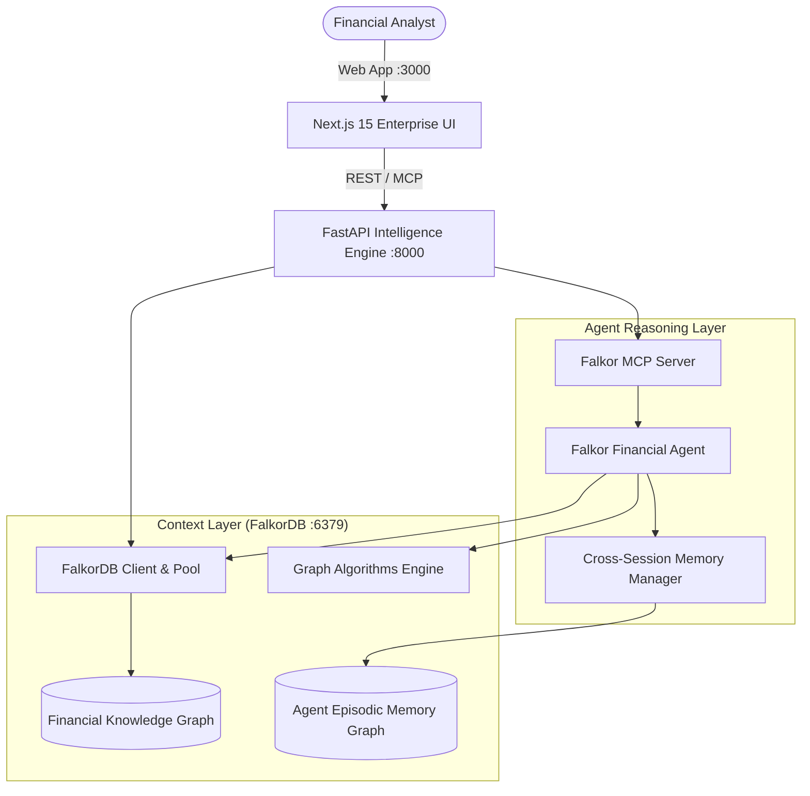
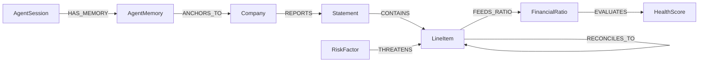

# 🏆 FinDoc: Graph-Native Financial Intelligence Agent
### Graph Hacks: Context for AI Agents — Powered by FalkorDB

> **Team**: RAGify (Team Code: `R4N93Q`)  
> **Team Members**:
> - **Tejas Rawool** ([@tejasrawool186](https://github.com/TejasRawool186)) — *Team Leader, Full-Stack Next.js 15 Architect & DevOps*
> **Repository**: [https://github.com/TejasRawool186/FinDoc-](https://github.com/TejasRawool186/FinDoc-)  
> **Demo Video (YouTube)**: [https://www.youtube.com/watch?v=J4goPNWRXeA](https://www.youtube.com/watch?v=J4goPNWRXeA)  

---

## 🎯 Track Alignment & Scoring Matrix

| Track | FinDoc Implementation | Status |
| :--- | :--- | :--- |
| **🕵️ Track 01 (Primary)<br>Agents That Act on Connected Data** | • Multi-hop Cypher reasoning across 10-K filings, line items, and ratios<br>• Graph algorithms (PageRank systemic risk centrality, shortest contagion path) as first-class agent tools<br>• Standardized **Model Context Protocol (MCP)** server for autonomous tool selection<br>• 100% explainable answers with executed Cypher query, latency, and path proof | ⭐ **PRIMARY ENTRY** |
| **🤖 Track 02 (Secondary)<br>Agent Memory & Coordination** | • Persistent episodic and semantic memory topologies inside FalkorDB (`AgentSession` -> `AgentMemory` -> `Company`)<br>• Cross-session continuity: agents recall past analyses, prior user questions, and reasoning chains<br>• Multigraph tenant isolation per company or analyst workspace | 🌟 **FULLY COVERED** |
| **🧠 Track 03 (Secondary)<br>Company Brain** | • Comprehensive corporate knowledge graph unifying tabular balance sheets, income statements, cash flows, and qualitative risk disclosures<br>• Lineage tracing from executive health score down to exact page-level source chunk | 🌟 **FULLY COVERED** |

---

## 💡 The Problem & Why FalkorDB is Critical

Standard LLMs and flat vector search (Dense RAG) consistently fail in corporate financial intelligence:
1. **Blind to Relationships**: A vector search retrieves isolated text snippets but cannot answer: *"If supply chain risks increase cost of goods sold, how does that cascade to operating margin and debt serviceability?"*
2. **Hallucination on Accounting Logic**: LLMs guess calculations instead of following deterministic accounting identities.
3. **Loss of Session Continuity**: Agents lose context between sessions, forcing analysts to re-explain multi-year financial context.

### The FalkorDB Shift
In FinDoc, **FalkorDB acts as the agent's deterministic context layer**:
- Corporate filings are parsed into a graph topology: `(:Company)-[:REPORTS]->(:Statement)-[:CONTAINS]->(:LineItem)-[:FEEDS_RATIO]->(:FinancialRatio)-[:EVALUATES]->(:HealthScore)`.
- Qualitative 10-K risk disclosures are modeled as `(:RiskFactor)-[:THREATENS]->(:LineItem)`.
- When an analyst asks a question, the agent traverses multi-hop edges to reconcile statements, compute risk centrality via PageRank, and return an answer backed by mathematical lineage.

---

## 🏗️ System Architecture



---

## 🛠️ FalkorDB Graph Schema



---

## ⚡ Multi-Hop Cypher Reasoning in Action

### 1. Risk Contagion to Solvency Score (Track 01)
```cypher
MATCH path = (rf:RiskFactor {company: $company, category: $risk_category})
             -[:THREATENS]->(li:LineItem)
             -[:FEEDS_RATIO]->(fr:FinancialRatio)
             -[:EVALUATES]->(hs:HealthScore)
RETURN rf.description AS risk, li.canonical_name AS impacted_item,
       fr.name AS impacted_ratio, fr.value AS ratio_value,
       hs.overall_score AS health_score
```

### 2. PageRank Systemic Risk Centrality (Track 01)
```cypher
MATCH (rf:RiskFactor {company: $company})-[t:THREATENS]->(li:LineItem)
OPTIONAL MATCH (li)-[f:FEEDS_RATIO]->(fr:FinancialRatio)
RETURN rf.category AS risk_category,
       count(DISTINCT li) AS line_items_threatened,
       count(DISTINCT fr) AS ratios_compromised,
       (count(DISTINCT li) * 2.5 + count(DISTINCT fr) * 4.0) AS systemic_centrality_score
ORDER BY systemic_centrality_score DESC
```

### 3. Cross-Statement Reconciliation (Track 01)
```cypher
MATCH (ni:LineItem {company: $company, canonical_name: 'NET_INCOME'})
MATCH (ocf:LineItem {company: $company, canonical_name: 'OPERATING_CASH_FLOW'})
RETURN ni.value AS net_income, ocf.value AS operating_cash_flow,
       (ocf.value - ni.value) AS accrual_delta,
       CASE WHEN ocf.value >= ni.value THEN 'Solid Cash Conversion'
            ELSE 'Accrual Quality Warning' END AS earnings_quality_flag
```

---

## 🔌 Model Context Protocol (MCP) Integration

FinDoc includes a native **Model Context Protocol (MCP)** server ([`app/mcp/falkor_mcp_server.py`](file:///d:/Financial-Document-Intelligence-RAG-Analytics-Platform/app/mcp/falkor_mcp_server.py)) exposing FalkorDB tools:
- `falkor_query_graph`: Natural language to Cypher traversal
- `falkor_get_risk_pagerank`: Algorithmic risk centrality score
- `falkor_get_shortest_contagion_path`: Risk-to-solvency graph path
- `falkor_get_company_subgraph`: Subgraph extraction
- `falkor_reconcile_statements`: 3-statement reconciliation

External agents or tools can discover and execute these tools at:
- `GET /api/v1/mcp/tools`
- `POST /api/v1/mcp/call`

---

## 🚀 1-Click Reproduction & Verification

To run the complete platform locally:

```powershell
# 1. Clone & spin up all containers
git clone https://github.com/TejasRawool186/FinDoc-.git
cd FinDoc-
docker compose up -d

# 2. Seed multi-year corporate graph topologies (Tesla, Tata Motors, Reliance)
npm run seed:falkor

# 3. Access web apps
# Next.js Enterprise Frontend: http://localhost:3000
# Knowledge Graph Explorer: http://localhost:3000/graph
# Dual-Mode AI Chat: http://localhost:3000/chat
# FastAPI OpenAPI Docs: http://localhost:8000/docs
```
